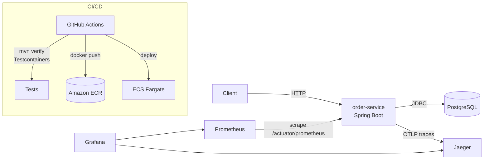

# Order Service — production-grade Spring Boot microservice

A REST order service built to show what "production-ready" means beyond the code:
**automated tests against a real database, CI/CD, containerised deployment to AWS ECS, metrics, dashboards and distributed tracing.**

| Area | What's here |
|---|---|
| API | Spring Boot 3.5, Java 21 (virtual threads), REST + OpenAPI/Swagger, RFC 9457 Problem Details errors |
| Data | PostgreSQL, Spring Data JPA, Flyway migrations, optimistic locking, N+1-safe queries |
| Testing | JUnit 5 + Mockito unit tests, **Testcontainers** integration tests against real PostgreSQL, JaCoCo coverage |
| CI/CD | **GitHub Actions**: build + test on every PR; on `main`, build image → push to ECR → rolling deploy to ECS |
| Cloud | **AWS ECS Fargate** task definition, Secrets Manager for DB credentials, CloudWatch logs, ADOT collector sidecar |
| Observability | **Prometheus** metrics (HTTP, JVM, DB pool, business metrics), **Grafana** dashboard, **OpenTelemetry** traces to **Jaeger**, trace IDs in logs |

## Architecture



## Run locally (Windows / macOS / Linux)

Needs Docker Desktop only.

```powershell
cd order-service
docker compose up -d --build
```

| URL | What |
|---|---|
| http://localhost:8080/swagger-ui.html | API docs, try requests here |
| http://localhost:8080/actuator/health | Health (liveness/readiness under `/health/liveness`, `/health/readiness`) |
| http://localhost:8080/actuator/prometheus | Raw metrics |
| http://localhost:9090 | Prometheus |
| http://localhost:3000 | Grafana (admin / admin) → Dashboards → *Order Service* |
| http://localhost:16686 | Jaeger traces (service: `order-service`) |

> Port 8080 must be free. If another app (e.g. your RAG service) is running on 8080, stop it first or change `"8080:8080"` to `"8081:8080"` in `docker-compose.yml`.

Stop everything: `docker compose down` (add `-v` to also delete the database).

### Run from your IDE instead

```powershell
docker compose up -d postgres prometheus grafana jaeger
mvn spring-boot:run
```
The app connects to Postgres on `localhost:5433` (5433 so it doesn't clash with a local Postgres on 5432).
To get metrics in Prometheus/Grafana in this mode, switch the scrape target in `observability/prometheus/prometheus.yml` to `host.docker.internal:8080` and run `docker compose restart prometheus`.

## Try the API

PowerShell:

```powershell
# Create an order
$order = Invoke-RestMethod -Method Post http://localhost:8080/api/v1/orders -ContentType "application/json" -Body '{
  "customerId": "cust-42",
  "items": [
    {"productCode": "SKU-1", "quantity": 2, "unitPrice": 19.99},
    {"productCode": "SKU-2", "quantity": 1, "unitPrice": 5.00}
  ]
}'
$order

# Get it
Invoke-RestMethod http://localhost:8080/api/v1/orders/$($order.id)

# Move it through the lifecycle: CREATED -> PAID -> SHIPPED -> DELIVERED (or CANCELLED)
Invoke-RestMethod -Method Patch http://localhost:8080/api/v1/orders/$($order.id)/status -ContentType "application/json" -Body '{"status":"PAID"}'

# List a customer's orders (paged)
Invoke-RestMethod "http://localhost:8080/api/v1/orders?customerId=cust-42&page=0&size=10"
```

curl (Git Bash / Linux / macOS):

```bash
curl -X POST localhost:8080/api/v1/orders -H 'Content-Type: application/json' \
  -d '{"customerId":"cust-42","items":[{"productCode":"SKU-1","quantity":2,"unitPrice":19.99}]}'
```

Generate some traffic, then open Grafana and Jaeger to see the requests, latency percentiles and traces.

### Endpoints

| Method | Path | Description |
|---|---|---|
| POST | `/api/v1/orders` | Create order → `201 Created` + `Location` header |
| GET | `/api/v1/orders/{id}` | Order with items, `404` if missing |
| GET | `/api/v1/orders?customerId=&page=&size=` | Paged list, newest first |
| PATCH | `/api/v1/orders/{id}/status` | Status change; illegal transitions → `409 Conflict` |

Errors use Problem Details JSON, e.g. a validation failure:
```json
{ "status": 400, "title": "Validation failed", "detail": "One or more fields are invalid",
  "errors": { "customerId": "must not be blank", "items": "must not be empty" } }
```

## Tests

```powershell
mvn test      # unit tests only (fast, no Docker)
mvn verify    # unit + Testcontainers integration tests (Docker must be running) + coverage
```

- `OrderTest` — domain rules (totals, status lifecycle) with no Spring context.
- `OrderServiceTest` — service logic with a mocked repository; checks business metrics are recorded.
- `OrderApiIT` — full HTTP → DB tests against a real PostgreSQL started by **Testcontainers**, including Flyway migrations, validation errors, 404/409 handling and the Prometheus endpoint.

Coverage report: `target/site/jacoco/index.html`.

## Observability

**Metrics** (Micrometer → Prometheus): `http_server_requests_seconds` (rate, p95/p99 latency per endpoint), JVM memory/GC, HikariCP pool, plus business metrics `orders_placed_total` and `orders_status_changed_total{from,to}`.

**Dashboard**: `observability/grafana/dashboards/order-service.json` is provisioned automatically — orders created, requests/sec, 5xx error rate, latency percentiles, status transitions, heap, DB pool.

**Tracing** (Micrometer Tracing → OpenTelemetry OTLP → Jaeger): every request gets a trace; `@Observed` on service methods adds `create-order` / `change-order-status` spans. Logs include `[order-service,<traceId>,<spanId>]`, so a log line can be matched to its trace.

## CI/CD (GitHub Actions)

- `.github/workflows/ci.yml` — on every push and PR: `mvn verify` (unit + Testcontainers), upload test and coverage reports, build the Docker image.
- `.github/workflows/deploy.yml` — after CI succeeds on `main` (or manual run): AWS login via **OIDC** (no stored keys) → build & push image to **ECR** tagged with the commit SHA → render the ECS task definition → rolling deploy and wait for the service to be healthy.

## Deploy to AWS ECS (one-time setup)

Region in the workflow is `eu-central-1` (Frankfurt); change `AWS_REGION` for another region.

1. **ECR repository**
   ```bash
   aws ecr create-repository --repository-name order-service
   ```
2. **Database**: create an RDS PostgreSQL 16 instance with a database `orders`. Store the credentials in Secrets Manager as `order-service/db` with keys `username` and `password`.
3. **ECS**: create a Fargate cluster `order-service-cluster`, and an Application Load Balancer whose target group health check path is `/actuator/health/readiness`.
4. **IAM**
   - `ecsTaskExecutionRole` with `AmazonECSTaskExecutionRolePolicy` + `secretsmanager:GetSecretValue` on the DB secret.
   - `orderServiceTaskRole` with `AWSXrayWriteOnlyAccess` (for the OTel collector sidecar).
   - A GitHub OIDC deploy role trusted for your repo, allowed to push to ECR and update the ECS service. Save its ARN as the repo secret **`AWS_DEPLOY_ROLE_ARN`**.
5. **Task definition**: replace the `<AWS_ACCOUNT_ID>`, `<AWS_REGION>` and `<RDS_ENDPOINT>` placeholders in `infra/ecs/task-definition.json`, register it once, and create the ECS service `order-service` behind the ALB:
   ```bash
   aws ecs register-task-definition --cli-input-json file://infra/ecs/task-definition.json
   ```
6. Push to `main` — GitHub Actions deploys every new commit from then on.

> Cost tip: Fargate + RDS + ALB is not free-tier. Bring it up for a demo/screenshots, then scale the service to 0 and stop RDS.

In ECS, traces go to the AWS Distro for OpenTelemetry sidecar → **AWS X-Ray**, logs go to **CloudWatch** (`/ecs/order-service`), and the 10% trace sampling rate is set via `TRACING_SAMPLING`.

## Project layout

```
src/main/java/.../order/      domain, repository, service, controller, DTOs
src/main/java/.../web/        global error handling (Problem Details)
src/main/resources/db/migration   Flyway SQL migrations
src/test/java/                unit tests (*Test) and Testcontainers integration tests (*IT)
observability/                Prometheus config, Grafana datasources + dashboard
infra/ecs/                    ECS Fargate task definition
.github/workflows/            CI and deploy pipelines
Dockerfile                    multi-stage, layered jar, non-root, healthcheck
docker-compose.yml            app + Postgres + Prometheus + Grafana + Jaeger
```
