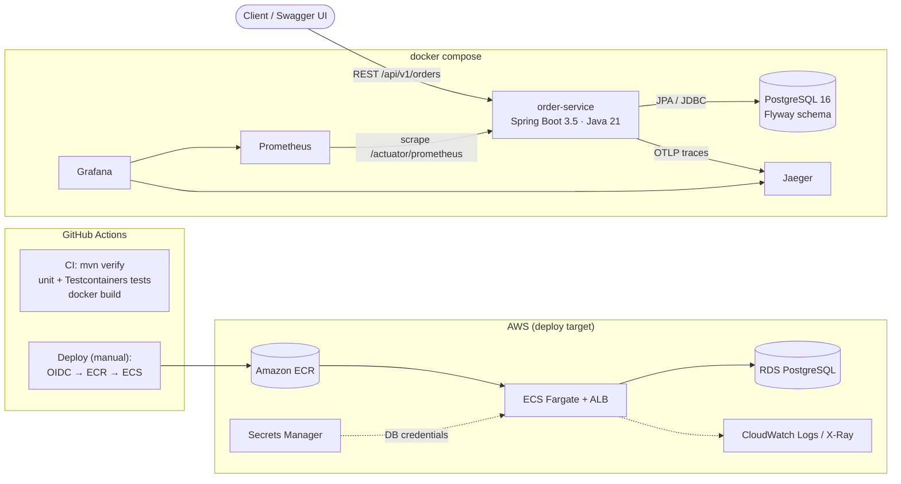
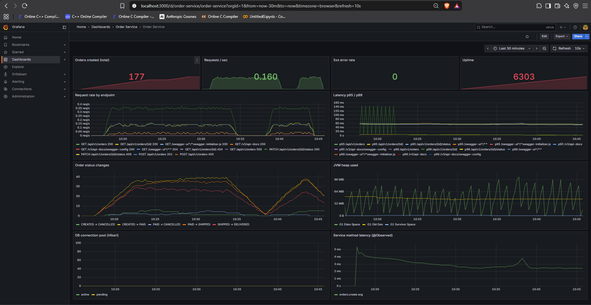
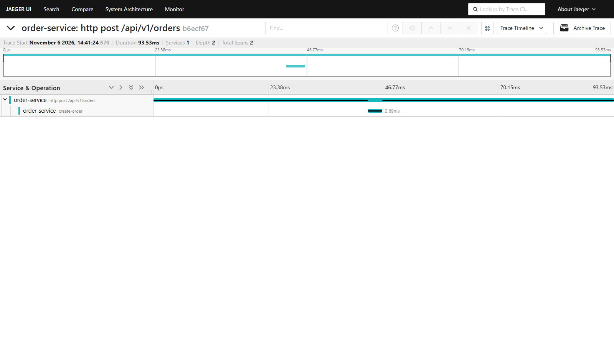
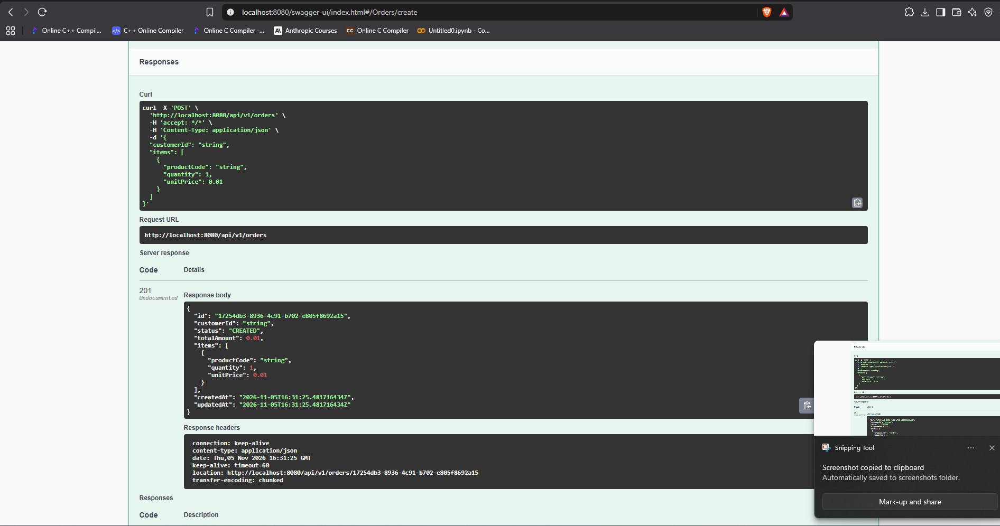
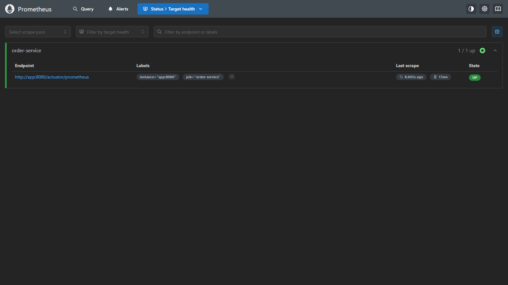
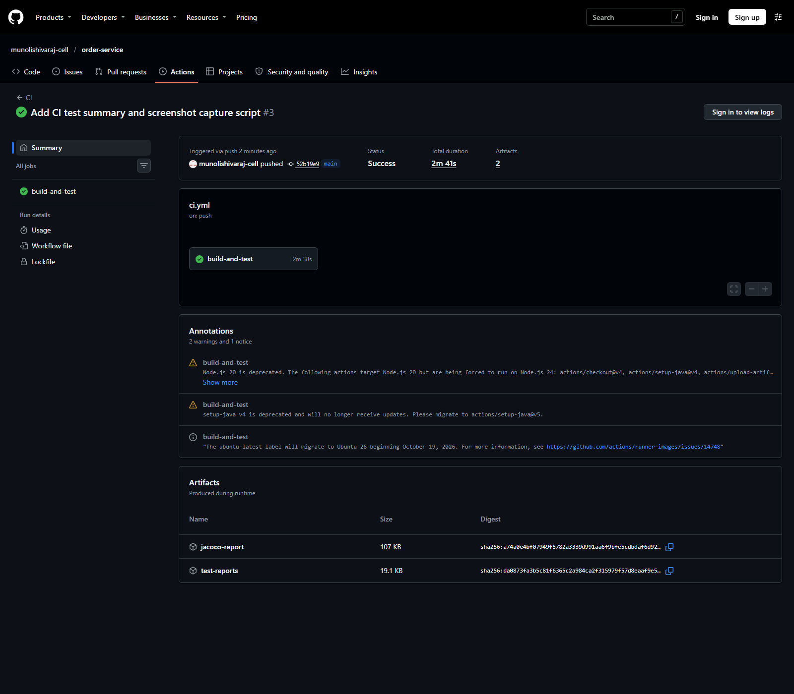
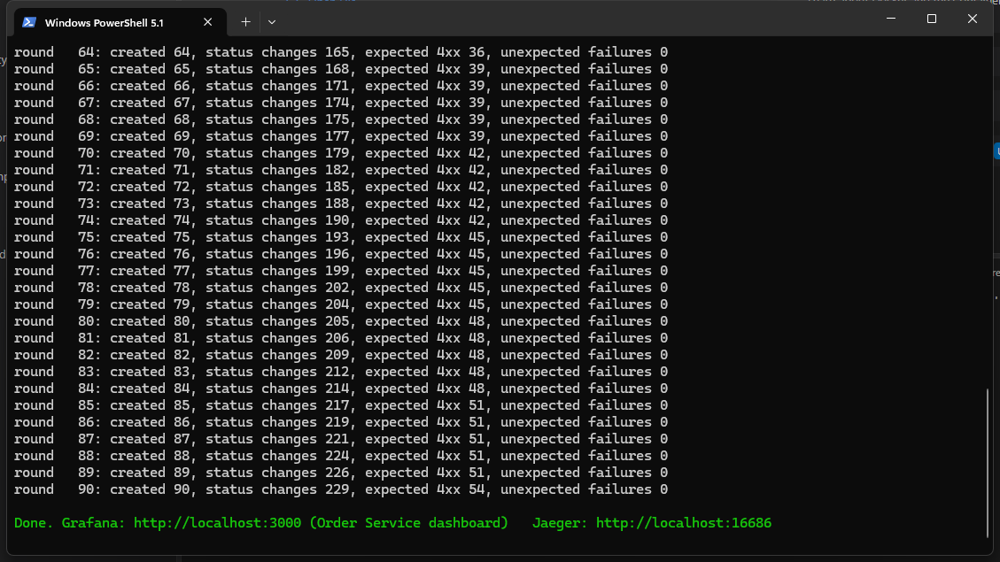

# Order Service – production-grade Spring Boot microservice

**A REST API for orders, built the way production services are: tested against a real database, containerised, observable with metrics, dashboards and traces, and shipped through CI/CD to AWS ECS.**

[](https://github.com/munolishivaraj-cell/order-service/actions/workflows/ci.yml)


[](LICENSE)

## What this demonstrates

- **Clean REST API design** with Spring Boot 3.5 and **Java 21 virtual threads**: DTOs separated from entities, Bean Validation, paging, `201 Created` + `Location`, and RFC 9457 **Problem Details** errors (400 / 404 / 409).
- **Domain rules in the domain model**: an order status state machine (`CREATED → PAID → SHIPPED → DELIVERED`, or `CANCELLED`) that rejects illegal transitions with `409 Conflict`.
- **Solid persistence**: PostgreSQL with **Flyway** migrations, JPA **optimistic locking** (`@Version`, concurrent updates return 409), indexed queries and an `@EntityGraph` fetch to avoid N+1 queries.
- **Testing pyramid**: JUnit 5 + Mockito unit tests, and **Testcontainers** integration tests that run the full HTTP → database flow against a real PostgreSQL. **JaCoCo** coverage report.
- **Observability**: Micrometer metrics in **Prometheus** (HTTP latency percentiles, JVM, DB pool, business counters), a provisioned **Grafana** dashboard, and **OpenTelemetry** distributed traces in **Jaeger**, with trace IDs in every log line.
- **Containers**: multi-stage Dockerfile with layered jar, non-root user and health check; one `docker compose` command starts the app with Postgres, Prometheus, Grafana and Jaeger.
- **CI/CD with GitHub Actions**: build, test and Docker image on every push and PR; a deploy pipeline to **AWS ECS Fargate** via ECR using **OIDC** (no stored AWS keys), with Secrets Manager for DB credentials.

## Architecture



**Request flow:** `OrderController` (validation, HTTP) → `OrderService` (transactions, metrics, `@Observed` spans) → `Order` aggregate (business rules, state machine) → `OrderRepository` (Spring Data JPA) → PostgreSQL.

## Tech stack

Java 21 · Spring Boot 3.5 (Web, Data JPA, Validation, Actuator) · PostgreSQL 16 · Flyway · springdoc-openapi (Swagger UI) · Micrometer + Prometheus · Grafana · OpenTelemetry + Jaeger · JUnit 5 · Mockito · Testcontainers · JaCoCo · Docker / Docker Compose · GitHub Actions · AWS ECS Fargate, ECR, RDS, Secrets Manager

## Run it locally (Windows)

**Prerequisite:** [Docker Desktop](https://www.docker.com/products/docker-desktop/) only. The app is built inside Docker, so no JDK or Maven is needed to run it.

Open **PowerShell** in the project folder:

```powershell
# 1. Build and start the app, PostgreSQL, Prometheus, Grafana and Jaeger
docker compose up -d --build

# 2. Check everything is up (app shows "healthy" after ~30 s)
docker compose ps

# 3. Generate orders and status changes so the dashboards and traces have data (Ctrl+C to stop)
.\scripts\generate-traffic.ps1
```

| URL | What you'll see |
|---|---|
| http://localhost:8080/swagger-ui.html | Interactive API docs; try every endpoint here |
| http://localhost:8080/actuator/health | Health (`/health/liveness`, `/health/readiness` for orchestrators) |
| http://localhost:9090/targets | Prometheus: the `order-service` target should be **UP** |
| http://localhost:3000 | Grafana (admin / admin) → Dashboards → **Order Service** |
| http://localhost:16686 | Jaeger: service `order-service`, operations `create-order`, `change-order-status` |

Stop everything with `docker compose down` (add `-v` to also delete the database).

> Port 8080 must be free. If PowerShell blocks the script, run `powershell -ExecutionPolicy Bypass -File .\scripts\generate-traffic.ps1`. Use `-Rounds 50` to stop after 50 orders.

<details>
<summary><b>Run the app from your IDE instead (needs JDK 21)</b></summary>

```powershell
docker compose up -d postgres prometheus grafana jaeger
mvn spring-boot:run
```

The app connects to Postgres on `localhost:5433` (5433 so it doesn't clash with a local Postgres on 5432). For metrics in this mode, change the scrape target in `observability/prometheus/prometheus.yml` to `host.docker.internal:8080` and run `docker compose restart prometheus`.
</details>

## API

| Method | Endpoint | Description | Responses |
|---|---|---|---|
| `POST` | `/api/v1/orders` | Create an order | `201` + `Location` header, `400` validation error |
| `GET` | `/api/v1/orders/{id}` | Get an order with its items | `200`, `404` |
| `GET` | `/api/v1/orders?customerId=&page=&size=` | List orders, newest first, paged | `200` |
| `PATCH` | `/api/v1/orders/{id}/status` | Change status (`PAID`, `SHIPPED`, `DELIVERED`, `CANCELLED`) | `200`, `404`, `409` illegal transition or concurrent update |

Status lifecycle: `CREATED → PAID → SHIPPED → DELIVERED`; `CREATED` and `PAID` orders can also be `CANCELLED`.

### Example requests (PowerShell)

```powershell
# Create an order
$order = Invoke-RestMethod -Method Post http://localhost:8080/api/v1/orders -ContentType "application/json" -Body '{
  "customerId": "cust-42",
  "items": [
    {"productCode": "SKU-1", "quantity": 2, "unitPrice": 19.99},
    {"productCode": "SKU-2", "quantity": 1, "unitPrice": 5.00}
  ]
}'
$order            # status CREATED, totalAmount 44.98

# Get it
Invoke-RestMethod http://localhost:8080/api/v1/orders/$($order.id)

# Pay it
Invoke-RestMethod -Method Patch http://localhost:8080/api/v1/orders/$($order.id)/status -ContentType "application/json" -Body '{"status":"PAID"}'

# List a customer's orders
Invoke-RestMethod "http://localhost:8080/api/v1/orders?customerId=cust-42&page=0&size=10"
```

Errors use Problem Details JSON, for example a validation failure:

```json
{
  "status": 400,
  "title": "Validation failed",
  "detail": "One or more fields are invalid",
  "errors": { "customerId": "must not be blank", "items": "must not be empty" }
}
```

## Tests

```powershell
mvn test      # unit tests only (fast, no Docker)
mvn verify    # unit + Testcontainers integration tests (Docker must be running) + JaCoCo report
```

| Test | Type | What it checks |
|---|---|---|
| [`OrderTest`](src/test/java/com/shivaraj/orderservice/order/OrderTest.java) | Unit, no Spring | totals, status state machine, illegal transitions |
| [`OrderServiceTest`](src/test/java/com/shivaraj/orderservice/order/OrderServiceTest.java) | Unit, Mockito | service logic with a mocked repository, business metrics recorded |
| [`OrderApiIT`](src/test/java/com/shivaraj/orderservice/order/OrderApiIT.java) | Integration, **Testcontainers** | full HTTP → JPA → real PostgreSQL with Flyway: create/get/list, 400/404/409, Prometheus endpoint |

Coverage report: `target/site/jacoco/index.html`. CI runs the full `mvn verify` (including Testcontainers) on every push and pull request.

## Observability

| Signal | How | Where to look |
|---|---|---|
| **Metrics** | Micrometer → Prometheus: `http_server_requests_seconds` (rate, p95/p99), JVM memory, HikariCP pool, business counters `orders_placed_total` and `orders_status_changed_total{from,to}` | http://localhost:9090 |
| **Dashboard** | [`order-service.json`](observability/grafana/dashboards/order-service.json), provisioned automatically: orders created, requests/sec, 5xx rate, latency p95/p99, status changes, heap, DB pool, service-method latency | http://localhost:3000 |
| **Traces** | Micrometer Tracing → OpenTelemetry OTLP → Jaeger; `@Observed` adds `create-order` / `change-order-status` spans | http://localhost:16686 |
| **Logs** | Every line includes `[order-service,<traceId>,<spanId>]`, so a log line can be matched to its trace | `docker compose logs app` |

## CI/CD

- **[`ci.yml`](.github/workflows/ci.yml)** runs automatically on every push and pull request: `mvn verify` (unit + Testcontainers), uploads test and coverage reports, and builds the Docker image.
- **[`deploy.yml`](.github/workflows/deploy.yml)** deploys to AWS ECS. It is **manual only** (`workflow_dispatch`): open the **Actions** tab → **Deploy to AWS ECS** → **Run workflow**. It logs in to AWS with **OIDC** (no stored keys), builds and pushes the image to **ECR** tagged with the commit SHA, renders the ECS task definition and does a rolling deploy that waits until the service is healthy.

## Deploy to AWS ECS

> **Why the deploy is manual:** deploying needs the one-time AWS setup below (ECR, RDS, ECS, IAM roles and the `AWS_DEPLOY_ROLE_ARN` secret). Running it only on demand means the repository never shows failed deploy runs before AWS exists, and nothing deploys or costs money unless you start it. To deploy on every push to `main` later, add a `workflow_run` trigger on the CI workflow to `deploy.yml`.

One-time setup (region in the workflow is `eu-central-1`; change `AWS_REGION` for another region):

1. **ECR repository:** `aws ecr create-repository --repository-name order-service`
2. **Database:** create an RDS PostgreSQL 16 instance with a database `orders`. Store the credentials in Secrets Manager as `order-service/db` with keys `username` and `password`.
3. **ECS:** create a Fargate cluster `order-service-cluster` and an Application Load Balancer whose target group health check path is `/actuator/health/readiness`.
4. **IAM:**
   - `ecsTaskExecutionRole` with `AmazonECSTaskExecutionRolePolicy` + `secretsmanager:GetSecretValue` on the DB secret.
   - `orderServiceTaskRole` with `AWSXrayWriteOnlyAccess` (for the OpenTelemetry collector sidecar).
   - A GitHub OIDC deploy role trusted for this repo, allowed to push to ECR and update the ECS service. Save its ARN as the repository secret **`AWS_DEPLOY_ROLE_ARN`**.
5. **Task definition:** replace the `<AWS_ACCOUNT_ID>`, `<AWS_REGION>` and `<RDS_ENDPOINT>` placeholders in [`infra/ecs/task-definition.json`](infra/ecs/task-definition.json), register it once and create the ECS service `order-service` behind the ALB:
   ```bash
   aws ecs register-task-definition --cli-input-json file://infra/ecs/task-definition.json
   ```
6. Run **Deploy to AWS ECS** from the Actions tab.

In ECS, traces go through the AWS Distro for OpenTelemetry sidecar to **AWS X-Ray**, logs go to **CloudWatch** (`/ecs/order-service`), and trace sampling is 10% (`TRACING_SAMPLING`).

> Cost tip: Fargate + RDS + ALB is not free-tier. Bring it up for a demo, then scale the service to 0 and stop RDS.

## Screenshots

### Grafana – Order Service dashboard
Request rate, p95/p99 latency, error rate, JVM and connection-pool panels, plus business counters, while `generate-traffic.ps1` runs.



### Jaeger – distributed trace of `POST /api/v1/orders`
The HTTP server span with the nested `create-order` span from `@Observed` and the JDBC work underneath.



### Swagger UI – Orders API
Interactive OpenAPI docs at http://localhost:8080/swagger-ui.html.



### Prometheus – scrape target UP
`order-service` scraped from `/actuator/prometheus` every 10 seconds.



### GitHub Actions – green CI run
Build, unit tests, Testcontainers integration tests and Docker image on every push, with a test summary on the run page.



### Traffic generator
`scripts/generate-traffic.ps1` drives orders through their lifecycle and sends some deliberately invalid requests (400 / 404 / 409).



<sub>To refresh the screenshots: start Docker Desktop and run `powershell -ExecutionPolicy Bypass -File .\scripts\capture-screenshots.ps1`. It starts the stack, generates traffic and captures the terminal, Swagger, Prometheus, Jaeger and CI images (the Grafana image is captured by hand, since Grafana needs a login).</sub>

## Project layout

```
src/main/java/.../order/          domain model, repository, service, controller, DTOs
src/main/java/.../web/            global error handling (Problem Details)
src/main/resources/db/migration/  Flyway SQL migrations
src/test/java/                    unit tests (*Test) and Testcontainers integration tests (*IT)
observability/                    Prometheus config, Grafana datasources + dashboard
infra/ecs/                        ECS Fargate task definition
scripts/generate-traffic.ps1      demo traffic for Grafana and Jaeger
scripts/capture-screenshots.ps1   captures the README screenshots
.github/workflows/                CI and deploy pipelines
Dockerfile                        multi-stage, layered jar, non-root, health check
docker-compose.yml                app + Postgres + Prometheus + Grafana + Jaeger
```

## License

[MIT](LICENSE) © Shivaraj Apparao Munoli
